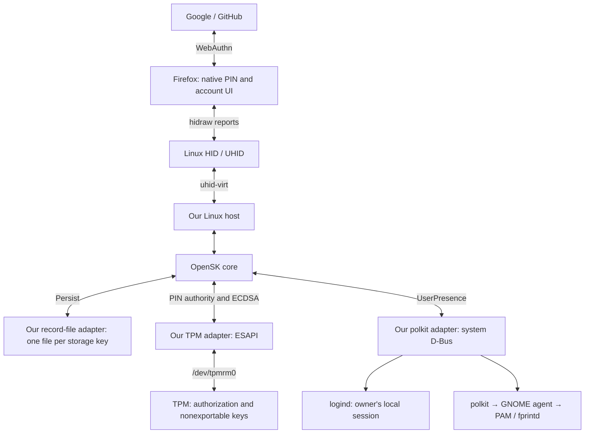

# Fidophir: concrete implementation plan

Revision: 4 November 2026. Target: Fedora 44 GNOME, the Fedora Firefox RPM, and Google/GitHub passkey login. This replaces the previous plan.

**Build a Linux host for OpenSK's standalone authenticator library, using direct TPM ESAPI, one file per persistent record, and GNOME's existing polkit agent.** No application UI, browser extension, privileged helper, PKCS#11 token, or second credential store.

This is an experimental implementation plan. OpenSK describes itself as a research platform, not a product for daily use. Reuse reduces protocol work; it does not confer an audit, certification, or production support. [Upstream status](https://github.com/google/OpenSK#readme)

## 1. Selected stack and ownership

Pin OpenSK commit **`8c81bc299886deb221beed35e2fe01a822649d67`**, specifically `libraries/opensk` and sibling `libraries/cbor`. Do not port its embedded OS or build the repository's firmware package. Its real `Env` trait provides the integration boundary. [Standalone library](https://github.com/google/OpenSK/tree/8c81bc299886deb221beed35e2fe01a822649d67/libraries/opensk)

| Component | Concrete dependency | Responsibility |
|---|---|---|
| Browser | Fedora Firefox, existing authenticator-rs backend | Origin checks, native PIN/account UI, ClientPIN client |
| Authenticator engine | Pinned OpenSK core, patched as §3 | CTAPHID channels/framing, CTAP/CBOR, PIN exchange, tokens, software retry rules, credential lifecycle |
| TPM | Fedora `tss-esapi` 7.6.0 + native `tpm2-tss` | Commands, TPM structures/marshaling, authorization sessions |
| Virtual HID | `uhid-virt` 0.0.8, locked `uhid-sys` dependency | Linux UHID ABI and event encoding |
| Storage | OpenSK's existing record encoding + GLib `file_set_contents_full` | One file per numeric storage key; atomic, durable record replacement; no SQLite or aggregate snapshot format |
| Desktop integration | Fedora `gio`/`glib` 0.22.10 + system GLib/GIO | System D-Bus calls, event dispatch and cancellation |
| OS calls / randomness | Fedora `nix` 0.31.3 and `rand` 0.10.3 | Typed clock/prctl calls and OS-seeded RNG; no custom syscall or RNG implementation |
| Protocol crypto | OpenSK's existing RustCrypto implementations | ClientPIN ECDH, AES, HMAC, HKDF, SHA-256; credential signing uses TPM |
| Operating system | systemd, udev, logind, polkit, GNOME agent, host PAM | Isolation, permissions, session selection, native approval |

OpenSK and `uhid-virt` were absent from the Fedora metadata checked here. Vendor their exact sources in the source RPM. Use Fedora Rust packages where available and native shared libraries; commit a lockfile, source checksums and license inventory, and build offline. This is not an all-Fedora stack. [Fedora ESAPI package](https://packages.fedoraproject.org/pkgs/rust-tss-esapi/rust-tss-esapi-devel/), [UHID binding](https://docs.rs/uhid-virt/0.0.8/uhid_virt/)

`libfido2` is an independent test client, not our authenticator engine. `tpm2-openssl` and `tpm2-pkcs11` do not simplify this parent-authorization design. Bash remains package-administration glue.



## 2. Deliberately limited profile

Version one creates **discoverable ES256 passkeys only**, requires user verification, and stores at most 64 credentials. Multiple accounts use OpenSK's normal credential lifecycle; there is no one-key-per-site rule. Signature counter zero uses `use_signature_counter=false` plus the host `Persist::global_signature_counter()` override returning zero; upstream's default initial value is one.

Build the library with `default-features=false`, `features=["software_crypto"]`. The Linux host uses Rust std, but production OpenSK does not enable `std`, `ctap1`, `config_command`, `vendor_hid`, `fingerprint`, `ed25519`, or `debug_ctap`. Upstream tests use the library's std test environment.

Customize `DEFAULT_CUSTOMIZATION`: `enforce_always_uv=true`, `allows_pin_protocol_v1=false`, minimum PIN length 8 code points, default `credProtect=UserVerificationRequired`, `max_supported_resident_keys=64`, `use_signature_counter=false`. Keep implemented CTAP2 extensions and credential management; do not replace them with custom subsets. No batch/enterprise attestation or hardware-certification claim; use zero AAGUID and the engine's unattested/self-attestation behavior. ClientPIN and presence remain separate protocol concepts. [CTAP 2.1 specification](https://fidoalliance.org/specs/fido-v2.1-ps-20210615/fido-client-to-authenticator-protocol-v2.1-ps-20210615.html)

Reject MakeCredential `rk=false` with `CTAP2_ERR_UNSUPPORTED_OPTION` before approval or TPM work. This restricted profile is **not a general FIDO2 conformance claim**. OpenSK's default nonresident wrapper has a 192-byte plaintext payload; arbitrary TPM public/private blobs do not fit. Resident records already accept opaque keys. We do not invent another wrapping protocol to preserve an out-of-scope feature. [Actual size constraint](https://github.com/google/OpenSK/blob/8c81bc299886deb221beed35e2fe01a822649d67/libraries/opensk/src/api/key_store.rs)

Initial PIN setup/change and credential management use Firefox **`about:webauthn`**. Do not assume website enrollment automatically creates a PIN: Firefox's client can return `PinNotSet`. Subsequent website operations use its native PIN dialog. [Firefox management UI](https://github.com/mozilla-firefox/firefox/blob/main/toolkit/components/aboutwebauthn/content/aboutWebauthn.html)

Chromium, sandboxed browser packages, U2F-only registration, synchronization, migration between TPMs and custom recovery are outside version one. Google/GitHub compatibility is a release test, not implied by unit tests. [Google requirements](https://support.google.com/accounts/answer/13548313?hl=en), [GitHub passkeys](https://docs.github.com/en/authentication/authenticating-with-a-passkey/about-passkeys)

## 3. Exactly what changes in OpenSK

These are **proposed patches**, not interfaces already present upstream. Keep each patch separate against the pinned source.

### A. Hardware PIN authority

Add `Env::PinAuthority` with this contract:

```text
is_set() -> Result<bool>
install(hash16, code_point_length) -> Result<()>
verify(hash16) -> Result<bool>              # TPM check; false means wrong authorization
replace_verified(new_hash16, length) -> Result<()>
matches_verified(hash16) -> bool            # current verified cache only
clear()                                    # zeroize H and unsealed master
```

`hash16` is ClientPIN's existing `SHA256(PIN)[0..16]`. It is PIN-equivalent secret material, never a stored software verifier.

Patch `ctap/client_pin.rs::verify_pin_hash_enc`: retain shared-secret decryption, exact-length checks, retry decrement, key-agreement regeneration and CTAP error handling; replace stored-hash comparison with `verify`. TPM lockout maps to authorization blocked, never success. Commit the software retry decrement **before** TPM verification; no outer transaction may roll it back after a crash.

Patch `check_and_store_new_pin`, `process_set_pin`, and `process_change_pin` to call install/replace. Retain engine PIN parsing and policy checks. Replace configured-PIN tests in GetInfo, MakeCredential, ClientPIN and `ctap/storage.rs::has_user_verification` with `is_set`; replace old-PIN equality checks with `matches_verified` using existing constant-time comparison. Remove Linux production paths to `Persist::pin_hash/set_pin` and `KeyStore::encrypt_pin_hash/decrypt_pin_hash`. Keep a software authority for upstream tests. Inventory remaining references with rg, including feature-gated code; no default software verifier may remain reachable in the production feature set.

Before another verification attempt, revoke the preceding token and clear its TPM cache. Clear again on verification failure, `ClientPin::reset_pin_uv_auth_token`, reset, and token expiry. Hook `update_timeouts` when token state changes from in-use to expired. The host invokes `Ctap::can_sleep()` at least every 100 ms while idle. In that wrapper, evaluate `state.can_sleep(&mut env)` before the wink check so its token observer cannot be skipped by boolean short-circuiting. Keep the engine's 30-second absolute token lifetime; no second token timer. An operation already admitted may finish within its existing presence timeout; do not promise instantaneous wall-clock memory erasure.

Initial SetPIN also requires native approval. Pass its existing Channel through to `process_set_pin`; approval precedes install. Otherwise any permitted hidraw client could silently claim the uninitialized device. Cancellation before the state commit leaves initialization unchanged; a commit already submitted must finish, even if the client subsequently cancels.

### B. Presence context

Extend `UserPresence::check_init` with `ApprovalRequest { operation, rp_id }`. Operation is a fixed enum: create passkey, sign in, select authenticator, initialize PIN, reset. RP text comes from the core's decoded request. Thread this through `check_user_presence` and its existing callers; no second CTAP parser.

Keep `wait_with_timeout`, `check_complete` and the engine's existing presence loop: it handles cancellation and busy channels, sends UP_NEEDED keepalives every 100 ms, and times out after 30 seconds. Our adapter runs within that loop. GetNextAssertion belongs to the same RP/challenge operation. [Presence trait](https://github.com/google/OpenSK/blob/8c81bc299886deb221beed35e2fe01a822649d67/libraries/opensk/src/api/user_presence.rs), [Existing loop](https://github.com/google/OpenSK/blob/8c81bc299886deb221beed35e2fe01a822649d67/libraries/opensk/src/ctap/mod.rs)

### C. Platform credential hooks and fatal faults

Keep upstream's crypto traits and `PrivateKey` API unchanged. Add only two optional
methods to `Env`: `new_credential_key(algorithm)` and
`sign_credential(key, message)`. Their defaults call the original software helpers.
The three CTAP2 call sites (creation, self-attestation, assertion) use those hooks;
Linux overrides them to call its existing backend. Keys contain only opaque TPM
blobs and public material. No thread-local backend lookup or per-key backend
reference is needed. Import/export and public-key access remain pure operations.

Linux's infallible `EcSecretKey::random` and `sign` methods are fail-stop guards:
reaching one exits with a diagnostic instead of creating a software key or signature.
They are not used by this CTAP2-only profile. Upstream's software implementation,
optional CTAP1 and their tests need no adaptations.

An unexpected TPM, storage or worker failure logs a sanitized error and exits with
status 1. Closing the Linux resource-manager fd releases its transient resources;
closing UHID removes the virtual device. The existing systemd unit restarts after
three seconds with the same service account and sandbox, limited to three starts
per minute. Restart discards PIN grants and tokens, preserves durable retry state,
and does not repair shared TPM lockout. A disconnected browser operation can fail
or time out; Firefox's precise UI/retry behavior still needs physical validation.
Expected incorrect PIN, hardware lockout, presence denial and cancellation remain
ordinary CTAP refusals. No empty signatures or software credential fallback.

The resident-only guard in §2 is the remaining profile change. A permanent rewrite of ClientPIN, cancellation or credential management would defeat this architecture.

## 4. Linux host and transport

Implement the real Env trait: Crypto selects OpenSK's software AES/ECDH/SHA/HMAC/HKDF and our TpmEcdsa. A local RNG wrapper forwards to `StdRng::try_from_rng(&mut SysRng)` using rand features std/std_rng/sys_rng, with startup failure if seeding fails. Clock uses `nix::time::clock_gettime(ClockId::CLOCK_BOOTTIME)` so suspend counts; default timers are expired. `nix::sys::prctl::set_dumpable(false)` runs before secrets. Enable nix process/time features. Write discards disabled debug output. Persist/KeyStore/UserPresence/PinAuthority/HidConnection follow the contracts below. [Clock API](https://docs.rs/nix/0.31.3/nix/time/fn.clock_gettime.html), [Dumpability API](https://docs.rs/nix/0.31.3/nix/sys/prctl/fn.set_dumpable.html)

One thread executes OpenSK; one blocking-I/O worker owns ESAPI and performs record reads/listing/writes/deletions. A bounded channel permits one job in flight. No parallel CTAP execution, application request queue, broker or Tokio runtime. There is no application-wide credential-record cache: the filesystem is authoritative and the kernel supplies ordinary file caching. The worker never decides presence or credential policy. Worker messages move owned parameters/results, and the protocol thread pumps transport during reads as well as writes and TPM operations.

The environment passes the backend explicitly through patch C. No thread-local backend registry, per-key backend back-reference, unsafe global pointer or cross-thread Env borrowing. The short-lived PIN authorization/master cache required by the engine's token lifecycle remains; it is separate from the eliminated record cache.

### UHID, not a USB gadget

Create one `uhid-virt::UHIDDevice<File>`. Identity: name `Fidophir TPM`, Bus::VIRTUAL (0006), vendor 0000, product 0001, unique string `fidophir-v1`. Fixed descriptor: FIDO usage page 0xF1D0, usage 1, unnumbered 64-byte input/output, no feature reports. No libusb, USB/IP, configfs or controller driver.

Accept Output only with exactly 64 bytes; forward unchanged to `Ctap::process_hid_packet(..., Transport::MainHid)`. Write every returned frame through the binding, checking the full UHID-event syscall count, not a mistaken 64-byte write count. Unsupported GetReport/SetReport receive positive EIO with their original request IDs. Start must indicate unnumbered reports. Stop/permanent I/O failure ends service. Open/Close represent aggregate usage, not browser identity. Closing the fd removes the device. [Kernel UHID contract](https://docs.kernel.org/hid/uhid.html)

The binding opens nonblocking but exposes no pollable fd. Use its public read API in a bounded loop, dispatch GLib events and sleep at most 5 ms between attempts. This costs up to 200 idle wakeups/second and avoids another fork. No handwritten ABI layouts or report reassembly.

Firefox enumerates hidraw and recognizes the FIDO descriptor. Its inspected Linux implementation has a two-second read timeout; TPM work cannot stop transport progress. [Mozilla implementation](https://github.com/mozilla/authenticator-rs/blob/2fca5688f849866f2b1eea7d0bb90c6b08a95d20/src/transport/linux/device.rs)

During a worker job, pump the same I/O loop and send PROCESSING keepalives every 100 ms. Reuse OpenSK's public `CtapHid::process_single_packet`, `keepalive`, and `busy_error` helpers. The active CID is scoped to the outer process_hid_packet call. On same-channel Cancel during a TPM/read job, drain its result and discard any signature/new blob/read result; return cancellation. A command already issued may finish, but its canceled result never reaches Firefox. A durable-state commit is different: finish it before honoring pending cancellation, never undo a PIN retry decrement or pretend a committed PIN change did not occur. No record-cache reconciliation is needed. Do not start a successor until the worker finishes. A ten-second worker deadline exits the process if stuck, rather than leaving a reusable abandoned worker.

No transport identity identifies the initiating Firefox fd. Tokens remain engine/CTAP scoped, not browser-fd bound.

### Persistence

Use `/var/lib/fidophir/v1/`, directory 0700, record files 0600, umask 0077. Each filename is the storage key formatted as exactly five decimal digits. File contents are the bytes OpenSK already supplies: no outer CBOR snapshot, manifest, index or additional per-credential serializer. The layout version is the v1 directory; unfamiliar layouts fail startup rather than initialize over old state. Engine keys 0..4095; reserve 65536 for our versioned TPM-parent record. The parent record continues to use existing sk-cbor. No website-controlled pathnames.

```text
/var/lib/fidophir/v1/
  01700    credential: wrapped TPM key + RP/user metadata
  01701    another credential
  02044    OpenSK PIN retry state
  65536    P/S blobs + PIN configuration/length, bundled together
```

This is one file per **storage record**, including one per credential, not separate files for a key's public blob, private blob and account metadata. OpenSK already serializes each credential as one record, and replacing an existing account credential reuses that record's slot. [Actual credential replacement](https://github.com/google/OpenSK/blob/8c81bc299886deb221beed35e2fe01a822649d67/libraries/opensk/src/ctap/storage.rs)

Acquire the directory lock before scanning the store. Allow at most 128 canonical record files, each at most 4096 bytes, alongside the engine's 64-credential limit. Bound reads before allocating/decoding; reject symlinks, nonregular files, invalid filenames and wrong ownership/modes. OpenSK validates its own record contents when used; our parent record uses its versioned schema. Invalid contents fail closed without automatic reset. Unexpected directory entries fail startup; recognize only a canonical name followed by a dot and six ASCII alphanumeric characters as GLib temporary residue. Remove such regular private residue at startup and synchronize the directory; never promote it as recovery state.

`find(key)` asks the existing I/O worker to read that bounded record; missing means None. `iter` asks it for a bounded, sorted list of numeric filenames, excluding backend record 65536. These are operation-local results, not an application-wide cache. `insert(key, bytes)` durably replaces just that record; `remove(key)` unlinks it and calls `sync_all` on the directory fd before success (missing is a no-op). No BTreeMap mirror, cache invalidation, or post-commit cache publication. Directory synchronization makes deletion persistent across a crash. Read/list jobs use the same keepalive/cancellation pump as other worker jobs; measure full-store login latency in integration tests. [Directory fsync requirement](https://man7.org/linux/man-pages/man2/fsync.2.html)

Each Persist mutation is a separate commit: especially, persist retry record 02044 before attempting TPM PIN verification. Never defer writes to command completion. P/S/PIN configuration are bundled into record 65536, so setup/change requires one atomic replacement. Credential metadata and wrapped keys likewise remain together. No cross-file transaction protocol. Factory reset is outside this profile: boots_after_soft_reset=true keeps CTAP reset unavailable, and the Linux Persist reset hook returns NOT_ALLOWED; an unexpected RESET_COMPLETION marker fails startup. Administrator reset stops the service and removes the store explicitly. Software-engine tests retain upstream reset behavior.

Use `glib::file_set_contents_full(path, bytes, FileSetContentsFlags::CONSISTENT | FileSetContentsFlags::DURABLE, 0o600)`, enabling the existing glib crate's v2_66 feature. GLib owns temporary-file creation, file synchronization, atomic rename and directory synchronization. Do not use plain file_set_contents, ONLY_EXISTING, or overwrite-in-place; do not implement another journal or rename/fsync helper. Its operation can block, hence the existing I/O worker. [GLib write guarantees](https://docs.gtk.org/glib/func.file_set_contents_full.html), [Durability flags](https://docs.gtk.org/glib/flags.FileSetContentsFlags.html), [Pinned Rust binding](https://github.com/gtk-rs/gtk-rs-core/blob/0.22.10/glib/src/auto/functions.rs)

Hold an exclusive nonblocking advisory flock on the store-directory fd for the process lifetime, using existing nix Flock with its fs feature. The directory inode remains stable across record replacement. A second cooperating instance fails startup. Use a local Linux filesystem. A write/sync error has potentially uncertain commit status: stop and revalidate canonical record files on restart. Successful return means the updated record is durable subject to filesystem/storage guarantees; a crash before success may retain either version. Unrelated files are not a globally atomic snapshot; stop the service before making a consistent copy.

TPM Create produces wrapped blobs/transient objects only; crashing before a credential record commits leaves no persistent TPM key to garbage-collect. This layout maps directly to OpenSK's per-key persistence contract and removes our aggregate snapshot encoding and whole-store rewrites. It provides no additional rollback protection.

Implement the existing `KeyStore` trait as a resident-only adapter. `init` is a no-op; `reset` clears its volatile cache. `wrap_credential` returns an error (unreachable after the profile guard); `unwrap_credential` always returns Ok(None), because the engine searches resident records separately. Thus an allow-list ID from another device needs no TPM access. `cred_random(has_uv)` returns the corresponding 32-byte half of the authorized, sealed 64-byte master; the engine retains its existing per-credential derivation. Without authorization return an error. Old encrypt/decrypt-PIN-hash methods return errors and become unreachable after patch A. Do not implement `KeyStore::Helper` or use its software-PIN/default master-generation path. No encryption/wrapping keys for nonresident credentials are needed.

## 5. TPM objects and command contracts

Construct ESAPI with an explicit Device TCTI for `/dev/tpmrm0`, never an environment-selected remote/simulator TCTI. The kernel resource manager replaces any need for tpm2-abrmd. Read capabilities and test required algorithms/templates before publishing UHID. Never clear the TPM, alter hierarchy/lockout authorization, change DA settings, allocate NV indices or evict other applications' handles.

```text
R: deterministic owner-hierarchy ECC storage primary; empty owner authorization
└── P: random storage parent; authorization H = SHA256(PIN)[0..16]
    ├── S: sealed 64-byte engine master; empty child authorization
    └── K1, K2, ...: TPM-generated P-256 signing keys; empty child authorization
```

R/P: SHA-256 names, ECC P-256, restricted decrypt, AES-128-CFB storage protection; fixedTPM, fixedParent, sensitiveDataOrigin, userWithAuth; no alternative policy. P has **noDA clear**. S is fixed sealed data. K is P-256 ECDSA/SHA-256, unrestricted signing-only, fixed to TPM/parent, TPM-generated, no alternative policy. S/K authorization is intentionally empty: P authorization is enforced by **Load**. Never persist a loaded child or saved child context. [Load authorization](https://tpm2-tools.readthedocs.io/en/latest/man/tpm2_load.1/)

Template details are fixed in code: R/P asymmetric scheme and KDF Null; R noDA set, empty object auth; P noDA clear, H as object auth. K symmetric algorithm and KDF Null, ECDSA/SHA-256 scheme, signEncrypt set, decrypt/restricted clear, noDA set. S type KeyedHash with Null scheme, fixedTPM/fixedParent/userWithAuth/noDA set, sensitiveDataOrigin/signEncrypt/decrypt/restricted clear. Every authPolicy is empty; no adminWithPolicy or duplication path. S has supplied sensitive data; K/P have TPM-generated sensitive material. Reject an imported blob whose public template differs.

Create R before publishing the device and keep it in the worker; it contains no PIN authorization. Fix its exact template and empty creation inputs in a fixture for deterministic reconstruction. Nonempty owner authorization is unsupported; do not change it. P/S public/private blobs live together in record 65536; no persistent TPM handle.

| Operation | ESAPI sequence and result |
|---|---|
| First PIN | After native approval: Create P under R with H; Load P; Create S under P/H with an OS-random 64-byte master; flush scoped handles; atomically commit P/S blobs and PIN length; clear temporary secrets. |
| Verify PIN | Load P under R; set candidate H on P; **Load S under P**; Unseal S only on success; flush S/P. Wrong H fails TPM authorization and contributes to DA protection. Only success enables a token and zeroizing H/master cache. |
| Create passkey | Load P; Create K under P/H; retain returned blobs; flush P. Engine writes the opaque key in its resident record. No raw private scalar is exported. |
| Sign | Load P; Load K under P/H; SHA-256 the engine message once; TPM Sign using ECDSA/SHA-256 and a null hash-check ticket; encode r/s using existing p256 DER support; flush K/P before return. |
| Change PIN | Verify old H; ObjectChangeAuth(P, R, new_H) authorized by old H returns new P private blob; commit it with new PIN metadata. Same parent name/seed keeps S/K usable. Revoke tokens and clear caches. |

Use salted HMAC sessions with request/response parameter encryption for sensitive creation/change inputs and Unseal output: start_auth_session, tr_sess_set_attributes, tr_set_auth, execute_with_sessions. Immediately scope each loaded P/S/K handle with tss-esapi 7.6's `execute_with_temporary_object`; it performs FlushContext after the closure returns, including Result error paths. Use it for newly allocated session handles as appropriate as well. Nest the existing helpers instead of adding our own handle registry, cleanup stack or RAII abstraction. A cleanup failure fails the operation. The long-lived R handle remains worker-owned; process termination closes the resource-manager fd. Keep explicitly salted session creation: `execute_with_nullauth_session` is not a substitute because that helper starts an unsalted session. Use ESAPI marshaling, never raw TPM packets. Worker messages/results are short-lived zeroizing values; the protocol backend holds the only authorization cache. [Pinned helper implementations](https://github.com/parallaxsecond/rust-tss-esapi/blob/tss-esapi-7.6.0/tss-esapi/src/context.rs)

Key export is deterministic CBOR `[version, marshaled_public, marshaled_private]`, each blob bounded to 512 bytes and the whole export bounded to 1100. Import validates version, object attributes, algorithm and P-256 point; rejects malformed/trailing input. Public coordinates come from the public blob. TPM-generated wrapped sensitive data is not an exportable scalar.

**Old parent copies remain usable with the old PIN after ObjectChangeAuth.** PIN change is not rollback protection or revocation. **DA state is shared**: hostile permitted clients can threaten other TPM uses through failed PIN attempts. Engine counters do not isolate hardware DA state. [Authorization-change warning](https://tpm2-tools.readthedocs.io/en/latest/man/tpm2_changeauth.1/)

No PCR policy, NV antirollback counter or measured-boot subsystem in this version. Salted sessions do not independently authenticate the initial salting key against an active interposer. Kernel-internal TPM protections do not automatically protect our userspace command stream. [Kernel TPM security documentation](https://dri.freedesktop.org/docs/drm/security/tpm/tpm-security.html)

## 6. Native desktop approval

Root-owned config names one owner's numeric UID and seat. On the **system bus**, call login1 Manager.ListSessions and read session properties. Require exactly one matching local, active graphical (wayland/x11) Class=user session on that seat, LockedHint=false. Reject ambiguity, remote/inactive/greeter sessions. Recheck the same session after approval. This is a gate, not atomic synchronization with screen lock. [logind API](https://www.freedesktop.org/software/systemd/man/latest/org.freedesktop.login1.html)

Through GIO call PolicyKit1 Authority.CheckAuthorization:

```text
subject      = ("unix-session", {"session-id": <selected ID>})
action_id    = "org.local.fidophir.use"
details      = {"operation": <fixed enum text>, "rp": <bounded display text>}
flags        = AllowUserInteraction
cancellation = fresh random operation identifier
```

Installed policy: allow_any=no, allow_inactive=no, allow_active=auth_self; owner annotation `org.freedesktop.policykit.owner=unix-user:fidophir`. The annotation permits this nonroot mechanism to check another user's authorization and provide details. No auth_self_keep, admin authentication or pkexec. Use polkit's implemented `$(operation)`/`$(rp)` message expansion. Bound RP text, reject controls and escape markup. It is client-supplied RP context, not independently verified browser-origin evidence. [polkit model](https://polkit.pages.freedesktop.org/polkit/polkit.8.html), [Owner/message implementation](https://github.com/polkit-org/polkit/blob/master/src/polkitbackend/polkitbackendinteractiveauthority.c)

First perform the same check without interaction; require authorized=false and challenge=true, rejecting silent grants and nonempty `polkit.retains_authorization_after_challenge`. Then interact; require success, no `polkit.temporary_authorization_id`, no dismissal, and the same eligible session. Modified administrator policy, GNOME agent and PAM remain trusted; the adapter cannot prove pixels were displayed or a fingerprint specifically was used.

check_init starts an asynchronous GIO operation. wait_with_timeout dispatches progress and returns raw incoming packets to OpenSK. check_complete always cancels outstanding work with CancelCheckAuthorization plus GIO cancellation. Result slots belong to that single check: a late callback cannot approve its successor. Agent absence, D-Bus error, denial, cancel and timeout fail closed. [Authority API](https://polkit.pages.freedesktop.org/polkit/eggdbus-interface-org.freedesktop.PolicyKit1.Authority.html)

GNOME owns the dialog; host PAM/fprintd supplies the Goodix path. On this machine, `/usr/lib/pam.d/polkit-1` includes `system-auth`, whose current auth stack contains `pam_fprintd.so`; this verifies the configured PAM path, not the actual prompt behavior. Password fallback is permitted. We neither enroll fingerprints nor call fprintd directly. Secret Service/GNOME Keyring Unlock can return without prompting or share unlocked state; it cannot supply this fresh approval contract. [Secret Service semantics](https://specifications.freedesktop.org/secret-service/0.2/unlocking.html)

The promise is fresh approval where the engine requires UP, not one dialog per signature. One assertion sequence can cover several accounts for the same request. Silent up=false probes and PIN-authorized credential management retain core semantics; websites must require/check UP for login. A briefly reusable PIN token is why this extra approval matters. The TPM does not verify GNOME approval.

```mermaid
sequenceDiagram
    actor U as You
    participant F as Firefox
    participant E as OpenSK + our host
    participant T as TPM
    participant G as GNOME / polkit
    U->>F: Sign in with passkey
    F->>U: Native security-key PIN dialog
    U->>F: Enter PIN
    F->>E: ClientPIN encrypted hash16
    E->>E: Decrypt; apply retry rules
    E->>T: Load check child under PIN parent
    T-->>E: Authorized or DA-protected failure
    E-->>F: Encrypted permission-scoped token on success
    F->>E: GetAssertion + token authorization
    E->>G: Fresh approval for sign-in RP
    G->>U: Native fingerprint/password prompt
    loop While waiting
        E-->>F: UP_NEEDED keepalive; process Cancel
    end
    U->>G: Approve
    G-->>E: Authorization result
    E->>T: Load credential under P/H; sign
    E-->>F: Assertion with UP/UV and signature
```

At PIN creation/change OpenSK decrypts the new PIN in daemon memory to validate/hash it. Ordinary verification exposes decrypted hash16 there. The TPM does not implement CTAP encryption or own the browser dialog.

## 7. Runtime identity and Fedora packaging

One system service, `/usr/libexec/fidophir`, locked static system account fidophir, private primary group fidophir, supplementary tss supplied by its unit. The primary fidophir group also grants UHID creation; there is no separate fidophir-uhid group or redundant static tss membership. Owner belongs to fidophir-client only for this device; never add the owner to fidophir or tss. No root execution, capabilities, setuid binary, listening socket or user-session filesystem access. systemd reads the root-owned owner configuration as EnvironmentFile; the binary validates its UID/seat variables without owning a file-format parser.

**Implemented package files are in `packaging/`**: service, sysusers, module loading, udev, policy and config format. Root installs these; the daemon never runs sudo/modprobe, edits policy or changes groups. Nothing has been installed/enabled here.

The unit uses NoNewPrivileges, empty capability/ambient sets, ProtectSystem=strict, ProtectHome, PrivateTmp, PrivateNetwork, AF_UNIX only, DevicePolicy=closed, only tpmrm0/uhid read-write. PrivateDevices=no deliberately preserves those device nodes. StateDirectory is the persistent writable location. Core dumps and cgroup swap are disabled; mark the process nondumpable before secrets. No memory-lock capability. Locked memory, hibernation exclusion and perfect wiping of dependency copies are not guaranteed. [systemd controls](https://www.freedesktop.org/software/systemd/man/latest/systemd.exec.html)

Both DAC and device cgroup access are required. UHID creation is root:fidophir, mode 0660; that private group has only the service account. A hidraw rule matches this virtual bus/vendor/product plus inherited HID_UNIQ, assigns fidophir-client:0660, and removes uaccess **after Fedora's 70-uaccess but before 73-seat-late installs ACLs**. Physical-token rules remain intact. A new login/Firefox process picks up group membership. These IDs are not unforgeable against another UHID creator.

Keep SELinux enforcing. Version one ships **no custom SELinux module** and claims no application-specific MAC confinement. Dedicated UID, DAC and systemd are the specified boundary. Fedora VM validation records the actual domain and verifies access with targeted policy; do not disable SELinux or apply blind audit2allow output to pass tests.

RPM uses systemd scriptlet macros, Fedora 44 RPM automatic sysusers processing, native-library runtime dependencies and a bundled-source inventory. Host GNOME supplies the agent; fprintd/PAM supplies optional biometrics. No automatic service enable/start or website enrollment in scriptlets. Upgrade preserves state; unknown schema refuses startup. No migration framework in v1. Uninstall stops the device and retains state. Destructive reset is an explicit administrator action, not an exposed management API.

Set boots_after_soft_reset=true: service restart is not physical authenticator power cycling and does not open the engine's factory-reset window. Forgetting the PIN requires administrator stop/state removal and re-enrollment; no attempt to clear shared TPM lockout. Retired state-file copies remain subject to the parent rollback limitation.

Startup: validate immutable owner config/private state/schema; mark nondumpable; initialize/check TPM worker; connect system bus; instantiate Env/OpenSK; publish UHID last. Missing dependencies fail visibly, never fall back. Exit/crash closes fds/removes the device. Bounded restart/start-rate limits prevent crash loops. Journal records category/error class only, not CTAP, PIN/hash, tokens, wrapped private data or RP/user inventories.

## 8. Security policy

With trusted service/kernel/browser/desktop, copied state contains no exportable credential private scalar. TPM authorization gates loading the keys. Normal website login requires protocol authorization and native approval. Other ordinary accounts lack service-state and this hidraw access. No IP-network or Linux capability requirement.

Compromising the daemon bypasses software UP checks and exposes cached H/master. Device allowlists do not filter TPM commands or stop arbitrary HID creation through an allowed UHID fd. There is no secure-enclave-style isolation from root/kernel, compromised browser/desktop, active TPM interposition or malicious device creators. No PCR integrity claim or metadata encryption at rest.

Lock checks are not atomic with signing; suspend/hibernation may preserve secrets. Shared DA lockout and old-parent rollback are accepted limits. Losing state/TPM loses passkeys. Deleting a local record does not revoke copied blobs; website revocation and an independent recovery factor remain necessary.

## 9. Build order and acceptance gates

| Order | Deliverable | Required evidence |
|---|---|---|
| 1 | Three interface patches and resident-only guard | Upstream tests still pass with software test authority; targeted tests cover rejected H, reset/expiry clearing, platform key hooks, SetPIN cancellation and RP context. Report patch size separately from vendor size. |
| 2 | TPM adapter on disposable swtpm | Protected sessions/exact attributes; correct/wrong PIN and DA lockout; restart; PIN change preserves K; old parent demonstrates rollback limit; no exported scalar or surviving child handle. |
| 3 | LinuxEnv/record-files/UHID/worker | Independent libfido2 or Python fido2 registers resident ES256, restarts and verifies assertions. Cancel during approval/TPM work releases no result; keepalives continue during durable writes; crash tests cover record creation/replacement/deletion, retry decrements, bundled PIN changes, sync failure, temporary residue, corrupt/oversized records and rejection of a second writer. |
| 4 | RPM files in Fedora 44 GNOME VM | Check actual UID/capabilities/device ACLs; system bus under sandbox; locked/inactive/wrong owner denial; missing agent and stale callbacks fail; fresh required prompts; SELinux enforcing. Record fingerprint and password behavior separately. |
| 5 | Laptop + Fedora Firefox RPM | about:webauthn setup/change/manage; **Google and GitHub passkey enrollment and login after restart/reboot**; multiple accounts, cancel, wrong PIN. Confirm tested flows need no nonresident registration. Record versions/prompts. |

Use synthetic credentials/accounts until hardware integration is established; tests must not alter global TPM policy. A failed gate does not authorize adding another engine or our own UI.

**Implementation evidence (2026-11-04):** the Rust implementation is in this directory. The patched core passes 346 library tests with --no-default-features --features std --lib and 393 with upstream defaults plus std. The host passes filesystem/HID unit tests and warning-free Clippy. Independent python-fido2 tests against disposable swtpm exercise full upstream CTAPHID framing, ClientPIN v2, TPM-backed registration/signing, hardware DA increment on wrong PIN, persistent retry lockout, token expiry, PIN change/restart, RP binding, credential enumeration and fail-stop handling of unexpected TPM errors. Native GIO login1/polkit wire tests use a private D-Bus double, covering rejected sessions/policy results, cancellation and stale callbacks. Old-parent rollback after PIN change is reproduced explicitly. These are simulator/private-bus tests, not physical-browser validation. See `VALIDATION.md` for precise results and remaining checks.

The three interface changes are delivered as one complete upstream patch because their call sites overlap; there is no TLS backend. Worker jobs use typed in-process closures over a bounded channel rather than a serialized command enum. The source includes a local Fedora RPM recipe, declarative installation files and an offline source bundler. The default workspace sandbox hides the device nodes; outside it, /dev/tpmrm0 is root:tss 0660 and /dev/uhid is root:root 0600. The current user cannot open either device, and noninteractive sudo requires a password; native GNOME, actual udev ACL matching, SELinux runtime behavior and Google/GitHub Firefox acceptance remain pending. No service or account has been installed on the host.

Upstream source is a pinned Git submodule at `vendor/OpenSK`. `make prepare` applies the reviewed patch to ignored build outputs; release bundles include that exact prepared library snapshot for offline builds.
