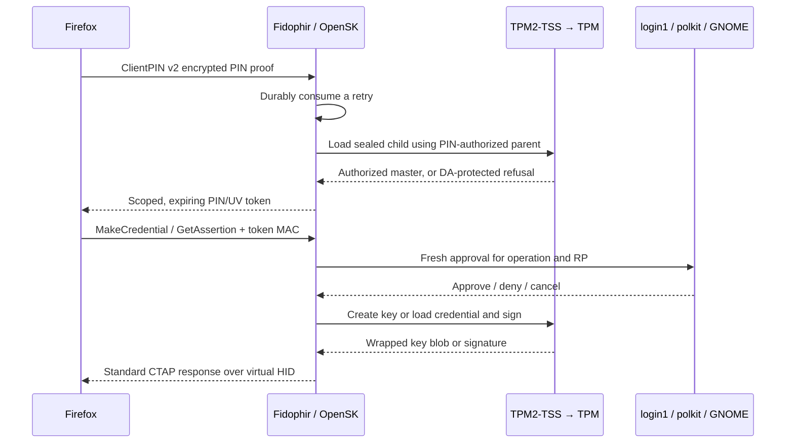

# Fidophir — experimental implementation

A single-owner Linux TPM authenticator for Firefox, with resident ES256 passkeys,
the browser's ClientPIN UI, and fresh desktop approval through login1/polkit.
No custom UI, SQLite, browser extension, network endpoint or runtime shell commands.

**Implemented and simulator-tested; physical TPM/UHID, GNOME and Firefox acceptance
is pending. Google/GitHub login is the target, not a verified compatibility claim.**
See [validation](VALIDATION.md) and the [design](DESIGN.md).
This is unaudited experimental security software, not a certified security key.



## What we own

| File | Responsibility |
|---|---|
| `src/main.rs`, `src/env.rs` | Serialized core loop, fixed profile, environment adapters |
| `src/backend.rs` | One typed blocking worker, fallible signing, PIN authorization lifetime |
| `src/tpm.rs` | Object templates, scoped ESAPI objects/sessions, create/load/change-auth/sign |
| `src/state.rs` | Bounded per-record files, exclusive directory lock, durable replacement/unlink |
| `src/io.rs` | UHID events; upstream HID framing, keepalives and busy replies |
| `src/approval.rs` | Native GIO login1/polkit calls and operation-scoped cancellation |
| `patches/opensk.patch` | Complete diff against pinned upstream OpenSK |
| `packaging/` | Unit, policy, device permissions, service accounts, local RPM recipe |

OpenSK is pinned to `8c81bc299886deb221beed35e2fe01a822649d67`; the repository references it through the `vendor/OpenSK` Git submodule.
The build uses only its standalone library and CBOR crate. `make prepare` applies
our patch into ignored `build/` outputs; the upstream checkout stays unchanged. The patch adds a PIN authority, presence
context, fallible ECDSA with an explicit backend context, and a resident-only guard.
See [patch notes](patches/README.md). Upstream owns CTAP parsing, PIN crypto,
permissions, token timers, credential management, CBOR and HID fragmentation.

The Rust graph is locked in `Cargo.lock`. GIO/GLib and TPM2-TSS are dynamically linked
Fedora libraries; `tss-esapi`, `gio`, `glib`, `uhid-virt`, `nix` and RustCrypto provide
bindings/helpers. The source bundle includes third-party Rust sources, hashes,
licenses and `DEPENDENCIES.tsv`. They are pinned crates.io sources, not a claim that
all Rust dependencies are Fedora-packaged. Native updates come through Fedora;
Rust dependency updates require rebuilding this program.

## Security contract and limits

* Credential private scalars are generated in the TPM and never exported in clear.
  Each credential file holds a fixedTPM/fixedParent public/private blob. TPM object
  slots are transient working space, not a per-credential storage limit.
* A deterministic owner primary **R** wraps a PIN-authorized storage parent **P**.
  A sealed child **S** verifies authorization when loaded under P and supplies a
  64-byte extension master. Credential signing keys **K** are children of P.
  Only P participates in TPM dictionary-attack protection. Wrong PINs reach the
  TPM; no software PIN verifier is written. The owner hierarchy must have empty
  authorization; startup fails if this machine policy is incompatible.
* HMAC sessions are salted to R. Parameter encryption protects secret inputs and
  the unsealed output where the TPM command supports it. Objects and sessions
  use the library's scoped cleanup. K is loaded for each signature and flushed.
* The daemon holds the PIN hash prefix and extension master only for OpenSK's
  successful authorization lifetime. Secret wrappers zeroize those Rust buffers.
  Expiry, PIN errors/change, cancellation paths that reset the token and process
  restart revoke the cached grant. This does not promise erasure of every copy
  inside native libraries, the kernel or a compromised machine.
* Every requested CTAP user-presence check requires a fresh `auth_self` challenge.
  Silent grants, retained/temporary authorizations, ambiguous/nonlocal/inactive/
  locked sessions and stale callbacks are rejected. GNOME's agent/PAM owns the UI
  and any fingerprint support; Fidophir never calls GNOME Keyring or fprintd.
  Desktop approval is separate from the TPM PIN. Protocol operations with `up=false`
  do not gain a fabricated physical touch; normal CTAP semantics remain upstream.
* State is mode 0700, files 0600, bounded and checked for ownership, links and type.
  GLib supplies durable atomic file replacement; deletion fsyncs the directory.
  Each record is atomic; a complete CTAP operation is not a multi-file transaction.
  Uncertain durable writes stop the process. There is no application record cache.
* PIN change rewrites P's private blob with `ObjectChangeAuth`, preserving children.
  **An old copy of P remains usable with its old PIN on the same TPM.** Neither
  PIN changes nor deleting a local credential revoke copied state. Revoke the
  website registration when revocation is needed. State has no rollback protection.
* TPM DA state is shared with other machine uses. Permitted hostile callers can
  cause denial of service. The program never clears the TPM, changes global DA
  configuration, takes persistent handles, or repairs hardware lockout.
* This trusts the kernel, root, service account, browser, desktop agent and host
  polkit/PAM policy. RP prompt text is client-supplied context, not proof of browser
  origin. Desktop lock checks are not atomic with signing. No PCR policy, antirollback
  NV counter, secure-enclave isolation or resistance to privileged live malware is claimed.

The fixed profile is discoverable ES256 only, 64 credentials, PIN minimum 8 code
points, ClientPIN v2 only, always-UV, default UV-required credential protection,
counter zero, zero AAGUID and self-attestation. No CTAP1, factory reset, fingerprint
enrollment, config/vendor/debug interface, remote TCTI or software signing fallback
ships in the default executable.

## Build and test on Fedora 44

Build prerequisites (administrator commands, not executed by the build):

```sh
sudo dnf install rust cargo gcc make clang-libs clang-devel pkgconf-pkg-config glib2-devel tpm2-tss-devel
```

From an extracted source bundle, with Rust/Cargo >= 1.92:

```sh
sha256sum --check SHA256SUMS
make build
make test
```

Builds are `--frozen` (locked and offline). For a Git checkout, initialize the one upstream submodule and prepare the patched
build sources before fetching dependencies (nested OpenSK submodules are unused):

```sh
git submodule update --init
make prepare
cargo fetch --locked
cargo fetch --locked --manifest-path build/opensk/Cargo.toml
```

Offline release bundles include the prepared library snapshot and need no submodule
checkout. `locks/opensk.Cargo.lock` pins the engine test dependencies. To make an offline source release from populated Cargo caches:

```sh
python3 tools/source_bundle.py --output dist
```

Optional integration prerequisites: `swtpm tpm2-tools python3-fido2 python3-gobject
dbus-daemon`. `make integration` uses disposable loopback TPM simulators and a
private D-Bus, with synthetic credentials only. It never connects to the host TPM,
GNOME agent, real system bus or website. It changes DA parameters on its disposable
simulator to exercise the separate persistent eight-attempt limit. Test transports
and fake approvals require the `integration-tests` feature and are excluded from
the default package. Do not deploy a binary built with that feature.

## Installation and first physical acceptance

Use the RPM or Debian 13 recipes in [packaging](packaging/README.md). The package does not
start the service, configure an owner, or enroll a website credential. `make install
DESTDIR=/absolute/staging/path` only stages files and has no activation hooks.

After reviewing and installing the package:

```sh
sudo dnf install ./dist/fidophir-0.1.0-1.fc44.x86_64.rpm
sudo install -d -m 0755 /etc/fidophir
sudo install -m 0600 /usr/share/doc/fidophir/owner.conf.example /etc/fidophir/owner.conf
sudoedit /etc/fidophir/owner.conf                 # Set the actual desktop UID and seat.
sudo usermod -aG fidophir-client YOUR_DESKTOP_USER
sudo modprobe uhid
sudo udevadm control --reload
sudo udevadm trigger --subsystem-match=misc --sysname-match=uhid
# Log out and back in to acquire the client group, then:
sudo systemctl start fidophir.service
```

The system service runs as `fidophir`, with its private primary group and only the
unit's supplementary `tss` group, empty capability sets, AF_UNIX only, closed device
policy allowing `/dev/tpmrm0` and `/dev/uhid`, read-only system files and a writable
state directory. The client gets only the generated hidraw node through
`fidophir-client`. Do not add the desktop user to `fidophir` or `tss`.

Before enrollment, perform the physical checklist in `VALIDATION.md`, particularly
the actual hidraw rule/ACL match and native fresh-approval behavior. The service
refuses root execution, missing/invalid owner configuration and incompatible state.
Failure is visible in `journalctl -u fidophir.service`; it does not print PINs or
credential contents. SELinux enforcing-mode behavior still needs physical testing.

Firefox `about:webauthn` is the intended PIN-management UI. Then test Google's and
GitHub's normal passkey enrollment and login with disposable accounts. No browser
provider or extension is installed. Keep existing account recovery methods while
validating this implementation. Enable boot startup explicitly only after acceptance:

```sh
sudo systemctl enable fidophir.service
```

Stopping/removing the service preserves `/var/lib/fidophir`. There is no automatic
reset or migration tool; unknown state layouts fail closed.
